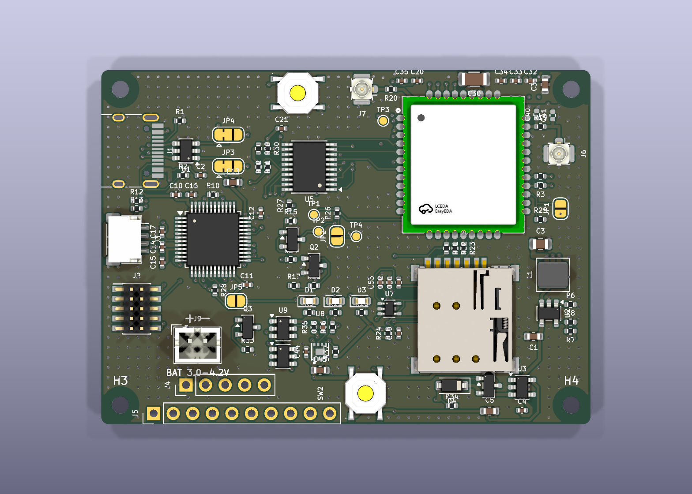

# LTE-M / NB-IoT sensor board: STM32L072 + SIM7080G (KiCad project, rev 0.3)

A KiCad 8 project (opens in KiCad 8 and 9) for a battery-powered board (1-cell Li-ion, e.g. 18650s in parallel; USB-C for power and programming) where an ultra-low-power
STM32L072CBT6 drives a SIMCom SIM7080G LTE Cat-M1/NB-IoT + GNSS modem, with a Qwiic/STEMMA QT I2C
port for temperature, humidity and UV sensors. Almost every part is in the LCSC/JLCPCB library, and
each symbol carries an `LCSC` field holding the JLCPCB part number.

Scope: schematic, BOM, and a **draft PCB layout** (`lte_board.kicad_pcb`, see [PCB layout (draft)](#pcb-layout-draft)).

## Files

| File | What it is |
|---|---|
| `lte_board.kicad_pro` / `lte_board.kicad_sch` | The project and the one-sheet A2 schematic |
| `lte_board.kicad_sym` + `sym-lib-table` | Project symbol library (all symbols are also embedded in the schematic) |
| `fp-lib-table` + `lte_board_lcsc.pretty/` | Footprints imported from LCSC (SIM7080G, SMN-303, TS-1187A, ...), with the fixes listed under PCB layout |
| SIMCom *SIM7080G Hardware Design* V1.04 | Not included (SIMCom's copyright). Get it from [SIMCom's SIM7080G page](https://www.simcom.com/product/SIM7080G.html); section numbers cited here refer to V1.04 |
| `bom_jlcpcb.csv` / `cpl_jlcpcb.csv` | JLCPCB BOM and placement (CPL) files, generated from the design and cross-checked to list exactly the same parts (see below) |

## Block overview

- **Battery input (rev 0.3):** **J9** JST PH 2.0 mm through-hole (B2B-PH-K-S), **pin 1 = +**. Check your pack's polarity: JST-PH battery leads have no universal convention, but a reversed pack is safe (see Q3).
  - **Q3** (AO3401A P-FET, gate to GND via R33) is reverse-polarity protection: it only conducts with the battery the right way round.
  - **U9 DW01A + Q5 FS8205A** (in the negative lead, BATT_N to GND) disconnect the cells on over-discharge (about 2.4 V), overcurrent or short (about 3 A), so bare cells are safe. They reconnect once the cells are recharged externally. No on-board charging.
  - **U8 MAX17048** fuel gauge on VBAT: I2C address 0x36 on the Qwiic bus, ALRT to **PA8**. Use it in firmware to stop uploads around 3.3 V; the DW01A is only the hardware backstop.
  - Battery life: about 2,000-2,500 mAh for 60 days of 15-minute uploads in typical coverage (see the power estimate).
- **VSYS:** USB 5V through Schottky **D4**, or the battery through P-FET **Q4**. Q4's gate is tied to USB 5V (R34 pull-down), so it turns off whenever USB is present, and USB never back-feeds the cells. VSYS feeds the modem buck and the 3.3V LDO.
- **USB-C** (J1, 5.1k CC pull-downs, USBLC6 ESD) gives +5V. **D1** (red) lights only when USB is connected; it no longer draws from the battery.
  - **U2 SY8089 buck** makes +3V8 (3.93V) for modem VBAT from VSYS. Below about 3.9V on the cell it runs at maximum duty and passes VSYS through (confirm 100% duty-cycle support in the SY8089 datasheet). The modem accepts 2.7-4.8V. Its EN pin is driven by MCU **PB1**, so firmware can hard power-cycle the modem; R6 keeps the modem off until firmware enables it.
  - **U3 TPS7A0233 LDO** makes +3V3 from VSYS for the MCU, level shifter, LEDs and sensors. Its 25 nA quiescent current keeps it out of the sleep budget (the ME6211 it replaced drew about 40 uA).
  - The MCU drives the buck EN through **R28 (1k)**, so **JP5** can force the 3.8V rail on without fighting a driven pin.
- **MCU:** STM32L072CBT6, with crystal-less USB FS. It can be programmed over **USB with ST's built-in DFU bootloader** (hold **SW2 BOOT0**, tap **SW1 RESET**, then flash with STM32CubeProgrammer or `dfu-util`) or over SWD (J2, 10-pin 1.27mm Cortex header). R10 pulls BOOT0 low for normal boot.
- **Level shifting:** the modem's logic is **1.8V** (2.1V absolute max). U5 TXS0108E translates all 8 UART/status lines between 3.3V and the modem's VDD_EXT (1.8V). OE is tied to VDD_EXT, so the shifter goes Hi-Z whenever the modem is off and nothing back-powers it.
  - **R29/R30/R31** (100k, pull-up) on RXD, DCD and CTS, and **R32** (100k, pull-down) on RI, hold the MCU-side lines in a safe state while the shifter is Hi-Z. SIMCom requires at least 47k on these lines with a shifter IC (V1.04 section 3.3); don't use the STM32's internal pulls (about 40k) instead.
- **Modem:** SIM7080G.
  - VBAT decoupling: 100uF + 10uF + 100nF + 33pF + 10pF, per SIMCom guidance.
  - **PWRKEY** is pulled low by NPN Q1 (MCU **PB0** high = button pressed). **NETLIGHT** drives a green LED via Q2.
  - **JP2** (+ R26 10k, per SIMCom) straps BOOT_CFG to VDD_EXT for USB download mode. Leave it open for normal use.
  - **R27** pulls the STATUS line low so the MCU reads "off" when the modem is unpowered and the level shifter is Hi-Z.
- **USB select (one USB-C port, two devices):** USB-C D+/D- go through the 3-pad solder jumpers **JP3 (D+)** and **JP4 (D-)**.
  - **Default, pads 1-2 bridged (pre-bridged on the board): USB goes to the MCU** (PA11/PA12) for the DFU bootloader or a USB device in firmware.
  - **Modem mode:** cut the 1-2 bridge on both jumpers and bridge 2-3. USB then goes to the modem through R3/R4 for SIMCom firmware updates, logs, or use as a USB modem from a PC. In modem mode, also:
    - bridge **JP1**, which feeds 5V to the modem's USB_VBUS (100k pull-down R25 when open). Keep it open in normal use: the modem can't sleep while USB_VBUS is present.
    - make sure the modem is powered before its USB lines see a cable (SIMCom: no voltage on any pin while VBAT is off). Either have firmware turn it on, or bridge **JP5**, which forces the 3.8V rail on.
    - start the modem with a PWRKEY press: firmware does it via PB0, or by hand, short **TP2 (PWRKEY)** to **TP4 (GND)** for about 1-2 s. Don't leave PWRKEY grounded, because the modem resets after 12.6 s.
- **SIM:** nano-SIM push-push holder with card detect (**R24 = 1M** pull-up; at 10k it drew about 330 uA all the time with a card inserted), 22R series resistors, 33pF caps and an ESD array.
- **RF:** LTE antenna on U.FL J6, through an R19/C40/C41 pi network (0R + DNP, to tune for your antenna). GNSS antenna on U.FL J7.
- **Expansion:** Qwiic J3 (I2C1, 4.7k pull-ups, 3.3V). J4 debug UART + BOOT0 and J5 spare GPIO are 2.54mm headers, DNP (hand-solder if wanted).

## MCU pin map

| STM32 pin | Function | Connects to |
|---|---|---|
| PA2 / PA3 | USART2 TX / RX | modem RXD / TXD (via U5) |
| PA0 / PA1 | USART2 CTS / RTS | modem CTS / RTS (via U5) |
| PA11 / PA12 | USB DM / DP | USB-C through JP4 / JP3 (default) |
| PB0 | GPIO out | PWRKEY driver Q1 (high = press) |
| PB1 | GPIO out | modem power enable (buck EN, through R28) |
| PB12 | GPIO in | modem STATUS (high = modem on) |
| PB13 | GPIO out | modem DTR (sleep control) |
| PB14 | GPIO in / EXTI | modem RI (wake on SMS/URC) |
| PB15 | GPIO in | modem DCD |
| PB6 / PB7 | I2C1 SCL / SDA | Qwiic J3 (sensors) |
| PA9 / PA10 | USART1 TX / RX | debug header J4 |
| PB4 | GPIO out | user LED D2 |
| PB5 | GPIO in | SIM card detect |
| PA8 | GPIO in / EXTI | MAX17048 fuel-gauge alert (low battery / SOC change), R37 pull-up |
| PA13 / PA14 | SWDIO / SWCLK | SWD header J2 |
| PA4-PA7, PB8, PB9, PB10, PB11 | spare (ADC, SPI1, I2C1 alt, I2C2) | expansion J5 |
| BOOT0 | boot select | SW2 to +3V3, R10 pull-down, J4 pin 5 |

## Modem power-on sequence (firmware)

1. Drive PB1 high (enables the 3.8V rail) and wait about 50 ms.
2. Drive PB0 high for about 1.2 s, then low. This holds PWRKEY low for that long; the modem needs at least 1 s.
3. Wait for PB12 (STATUS) to go high (at least 1.8 s). Then talk AT over USART2 at 115200 baud (the modem auto-bauds), with RTS/CTS optional.
4. To power off: send `AT+CPOWD=1` (or pulse PWRKEY again), wait for STATUS to go low, **then** drive PB1 low to cut the rail for zero sleep current. SIMCom warns that cutting VBAT while the modem runs risks corrupting its file system (V1.04 section 3.2.2), so use a hard cut only to recover a hung modem.

Recommended field strategy: keep the modem fully off between uploads. The MCU sleeps on its RTC (about 1 uA),
logs readings, and every N readings runs steps 1-4 to upload a batch. Arm the STM32 independent watchdog so a
stuck MCU recovers too. While the modem is off, U5 is Hi-Z and R29-R32 hold the MCU-side lines in a safe state,
so no internal pulls are needed. DTR and DCD are wired in case you later want UART sleep (`AT+CSCLK=1` + DTR)
or transparent-mode carrier detect. The power-off strategy doesn't need them.

**SIM cards:** the SIM7080G only supports **1.8V SIM cards**. Most modern IoT SIMs (1NCE, Hologram, etc.)
are fine; some old 3V-only cards won't be detected.

## Before layout: import the LCSC footprints

These parts use footprints that aren't in KiCad's standard library. Import them from LCSC/EasyEDA with
[easyeda2kicad](https://github.com/uPesy/easyeda2kicad.py) (run it in this project folder):

```
pip install easyeda2kicad
easyeda2kicad --footprint --3d --lcsc_id=C2943992 --output ./lte_board_lcsc   # U6 SIM7080G
easyeda2kicad --footprint --3d --lcsc_id=C266888  --output ./lte_board_lcsc   # J8 SMN-303 nano-SIM
easyeda2kicad --footprint --3d --lcsc_id=C318884  --output ./lte_board_lcsc   # SW1 (optional, replaces TL3342 stand-in)
easyeda2kicad --footprint --3d --lcsc_id=C279948  --output ./lte_board_lcsc   # L1 (optional, replaces MAPI-4030 stand-in)
easyeda2kicad --footprint --3d --lcsc_id=C145956  --output ./lte_board_lcsc   # J3 (optional, check vs JST SH footprint)
```

Then point each part's Footprint field at the imported footprint. Use Tools → Edit Symbol Fields,
or Footprint Assignment.

## Check these before ordering

1. **U7 ESDA6V1W5 pinout.** Pin 2 is the common ground and pins 1/3/4/5 are I/O. This was checked against a pin-compatible second-source datasheet (ElecSuper), not ST's own, so confirm once against ST's datasheet.
2. **J8 SIM holder pad numbers.** After importing the SMN-303 footprint, check that its pad numbers match the symbol: 1 = C1 VCC, 2 = C2 RST, 3 = C3 CLK, 5 = C5 GND, 6 = C6 VPP, 7 = C7 I/O, 8 = CD. Also check the card-detect polarity; firmware currently expects CD pulled low by the inserted card.
3. **Stock (JLCPCB, checked 2026-10-07):** STM32L072CBT6 C465977 (2,927), SIM7080G C2943992 (729), TXS0108EPWR C17206 (52k), TPS7A0233PDBVR C2887324 (8,010). Re-check before ordering.
4. **Basic vs Extended:** confirm in JLCPCB's parts search. Every Extended part adds a small setup fee.
5. **SIM7080G assembly:** JLCPCB lists it as MSL3 with X-ray inspection required, so pick an assembly option that includes that.
6. **Battery connector polarity:** J9 pin 1 is **+** (marked on the silkscreen). Reverse polarity is protected by Q3, but the board won't run until the pack is the right way round.
7. **USB power budget:** the board asks for USB default power (5.1k CC resistors, 500mA). Modem bursts (about 0.5A at 3.9V) fit, but avoid unpowered hubs and long, thin cables. There's no fuse on VBUS; add a polyfuse at layout time if you want one.

## PCB layout (draft)



- **Board:** 63.5 x 46 mm (2.5" x 1.81"), 4 layers, all parts on the top side. Everything is SMD except the battery connector J9 (through-hole, for strength) and the DNP headers J4/J5.
- **Mounting:** four M2 holes (2.2 mm, non-plated) centred 2.5 mm in from each corner. There is no copper, vias or parts under the screw heads (4.9 mm keep-out).
- **DRC:** clean (0 violations, 0 unconnected, matches the schematic).
- **Stackup use:**
  - F.Cu: signals + GND pour.
  - In1: solid GND, with no tracks under the modem/RF/SIM/buck half.
  - In2: signals + GND pour, plus a +3V8 strip from the buck to the modem VBAT pins. No tracks under the USB pair.
  - B.Cu: signals + GND pour.
  - GND stitching vias everywhere.
- **Placement:**
  - Modem top right, LTE U.FL (J6) on the right edge, GNSS U.FL (J7) on the top edge.
  - Nano-SIM below the modem; the card loads from the bottom edge. The 22R SIM resistors sit in the gap under modem pins 15-17.
  - USB-C and Qwiic on the left edge; the reset button is on the top edge; the buck is in the bottom-right corner.
  - Status LEDs are in the bottom middle, with the BOOT0 button SW2 below them.
  - **Battery block** (bottom left): J9, Q3, U9/Q5 protector, U8 fuel gauge. **USB/battery OR-ing** (D4, Q4) and the LDO U3 sit under the SIM holder, next to the buck.
  - **USB select jumpers JP4 (D-) / JP3 (D+)** sit just right of the USB ESD chip U1 (pad 1 = MCU side, pad 3 = modem side). **JP5** (modem power override) is under the MCU. **TP4** (GND) is next to **TP2** (PWRKEY), for starting the modem by hand.
- **Hand-routed:**
  - LTE and GNSS RF feeds (0.35 mm).
  - VBAT bus (0.6 mm) from pins 34/35 to all the VBAT caps.
  - USB D+/D-: J1 to U1 (flow-through) to the select jumpers on F.Cu. From the jumpers' modem side, a coupled pair runs on B.Cu to R3/R4 at the modem. The MCU side of the jumpers is short and autorouted (USB full-speed doesn't need impedance control).
  - +5V: a 0.5 mm B.Cu highway from J1 to the buck input.
  - Escape vias for modem pins 39-42.
- **Autorouted:** everything else, with Freerouting. It works electrically but meanders; tidy anything you care about. Rev 0.2's last four connections (BOOT0, EXP_PB9, the DCD pull-up and SIM_RST) were finished with a small grid maze router (`layout_scripts/maze_route.py`), so they're a bit stair-steppy.
- **Rules:** JLC-friendly. 0.15 mm default track/space, 0.5/0.3 mm vias, 0.6 mm VBAT, 0.3 mm power, 0.35 mm RF.

### USB pair impedance (90 ohm)

KiCad doesn't compute impedance. You choose a width and gap from a calculator and enter them in the net class.

- The `USB` net class is set to **0.30 mm width / 0.15 mm gap**. That's my estimate for about 90 ohm differential on JLC04161H-7628 (outer layer, 0.21 mm prepreg to the adjacent plane).
- **Before ordering**, check it in JLC's impedance calculator (Differential, Coupled Microstrip, L4 with L3 reference), or in KiCad's PCB Calculator under Transmission Lines.
- Order with JLC's impedance-control option on that same stackup.
- To adjust, change the diff-pair values in Board Setup -> Net Classes -> USB, then re-route with Route -> Differential Pair (shortcut 6). KiCad pairs `USB_DP`/`USB_DN` automatically from the P/N suffix.
- The RF feeds (0.35 mm, about 50 ohm) need the same check.

### Before ordering

1. Check the impedances above.
2. Review the autorouted traces, especially around the MCU and level shifter.

### Ordering at JLCPCB (BOM and CPL)

- Upload `bom_jlcpcb.csv` and `cpl_jlcpcb.csv`. Both are generated from the design (`layout_scripts/make_jlc.py`) and cross-checked to contain exactly the same designators. Every BOM line has an LCSC number.
- These are **deliberately not in either file**, because they aren't parts to place:
  - JP1-JP5 and TP1-TP4: copper-only solder jumpers and test pads;
  - C40/C41 and J4/J5: do-not-populate;
  - H1-H4: mounting holes.

  If you export a BOM yourself from KiCad, keep "exclude DNP" on. Otherwise JLC warns that those designators "don't exist in the CPL file" (harmless, but confusing).
- **J9 is through-hole.** Either enable JLC's THT assembly for it or leave it out of the order and hand-solder it (2 pins).
- Check rotations in JLC's placement preview, especially SOT-23/SOT-23-6, the TDFN U8, and polarized parts (LEDs, D4). KiCad and JLC sometimes disagree on a part's zero orientation.

**Footprint fixes made during layout (in `lte_board_lcsc.pretty/`):**

- The imported SIM7080G footprint was renamed to `SIM7080G` so the schematic link resolves.
- The SMN-303 pads were renumbered to match the symbol (1/2/3/5/6/7 = C1-C7, 8 = CD, 9-11 = shell GND), and its two locating pegs were made NPTH.
- SW1 now uses the real TS-1187A footprint (`SW_TS-1187A`). Only one diagonal pad pair is numbered, which is correct whichever way the internal pairs are wired.

`layout_scripts/` holds the Python that generates this board:

1. `gen_board.py`: placement.
2. `preroute.py`: hand routes, planes and keepouts.
3. `export_dsn.py`: export for Freerouting.
4. `postroute.py`, `stitch.py`, `fixup.py`, `drop_dangling.py`, `hole_keepouts.py` and `maze_route.py`: import, pours, stitching, cleanup and finishing leftover connections.
5. `sch_rev02.py`: the schematic edits that turned rev 0.1 into rev 0.2 (already applied; kept for reference).
6. `sch_rev03.py`: the rev 0.3 battery/fuel-gauge/VSYS schematic edits (already applied).
7. `final_fixes.py`, `silk_marks.py`: last clean-ups (bridging stray vias, GND island vias, J9 polarity marks).
8. `make_jlc.py`: writes `bom_jlcpcb.csv` + `cpl_jlcpcb.csv` from the netlist and KiCad's position file, and checks they list the same parts.

Run them with KiCad's bundled Python and Freerouting. They regenerate the board from scratch, so don't rerun them once you start hand-editing.

## Layout guidance (original notes)

- Use a 4-layer board (e.g. JLC04161H-7628) with solid ground on layer 2.
- Route RF_ANT and GNSS_ANT as **50 ohm grounded coplanar waveguide**, sized with JLCPCB's impedance calculator. Keep them short, stitch ground vias along both sides, and keep the module's RF area clear of other traces.
- Make VBAT (+3V8) traces at least 1.5-2 mm wide. Put C30-C34 right at the module's VBAT pads, and keep the buck (U2, L1, C1, C3) compact with a short ground return.
- Route USB D+/D- as a 90 ohm differential pair. Put U1 next to J1.
- Put the SIM holder close to the module, and the ESD array (U7) and 33pF caps next to the holder.
- Add mounting holes and an antenna keep-out or edge placement as needed.

## Sources

- SIMCom SIM7080G Hardware Design V1.04 (pinout, power, PWRKEY, BOOT_CFG, SIM, RF)
- SIMCom SIM7080 Series AT Command Manual V1.02
- ST STM32_open_pin_data (STM32L072C(B-Z)Tx pinout; the L071 and L072 differ only at pin 36, VDDIO2 vs VDD_USB)
- LCSC / JLCPCB part pages for every LCSC number in the BOM
